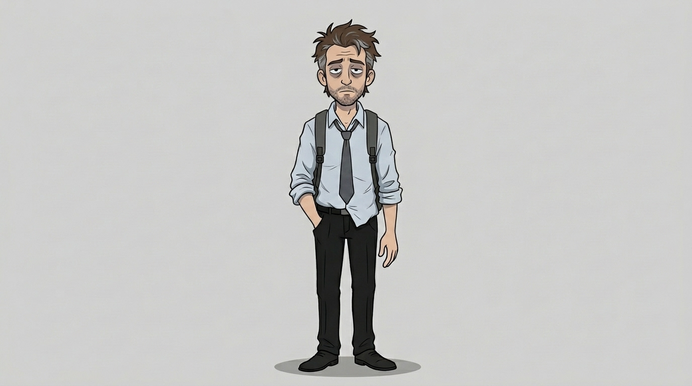
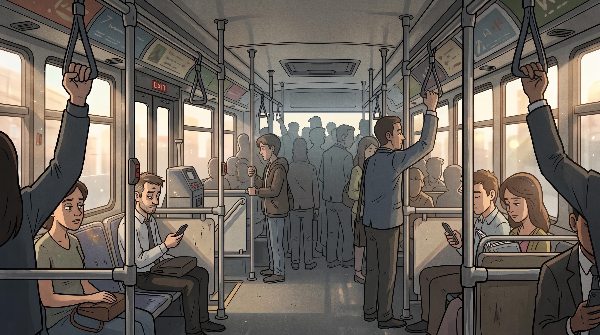
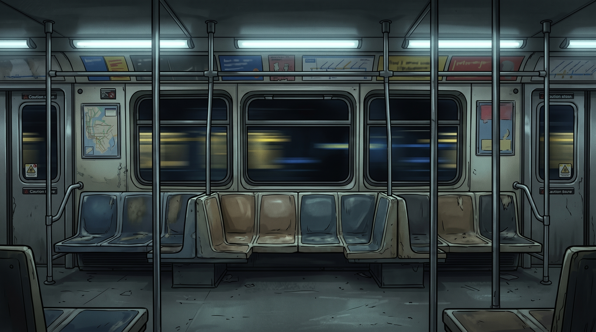
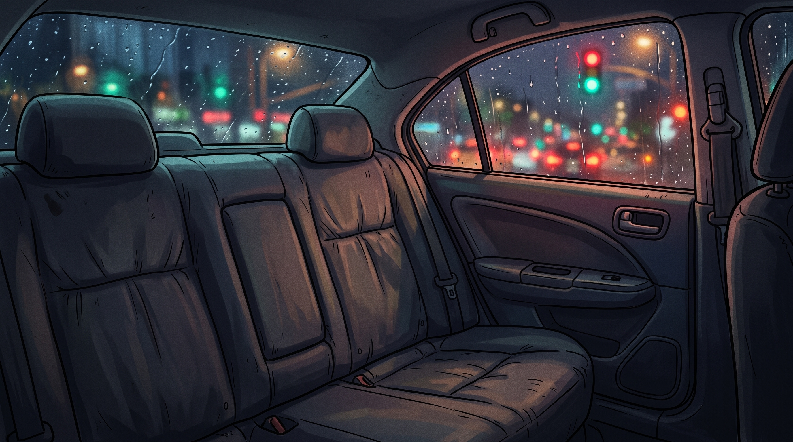
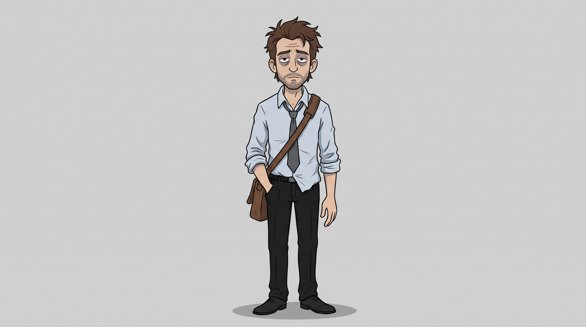
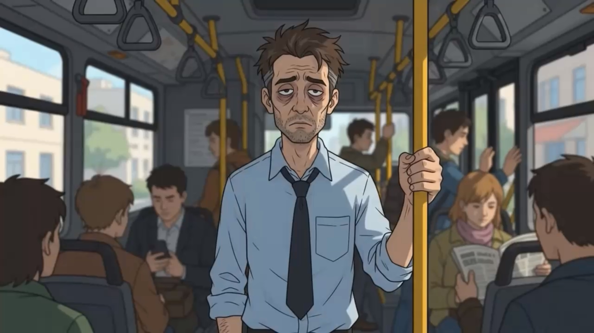
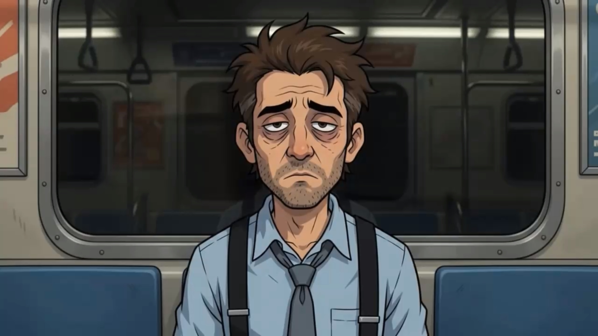
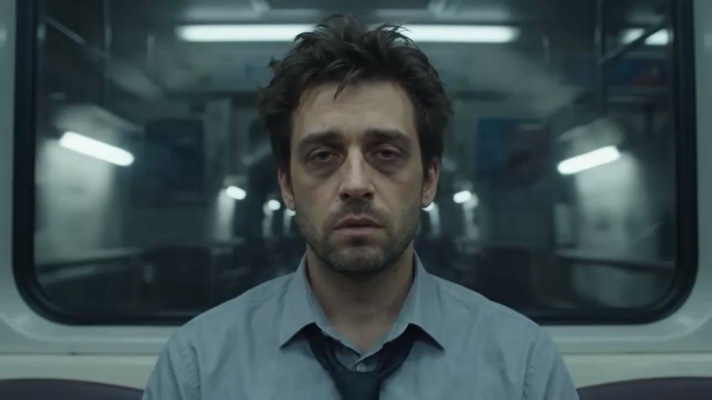
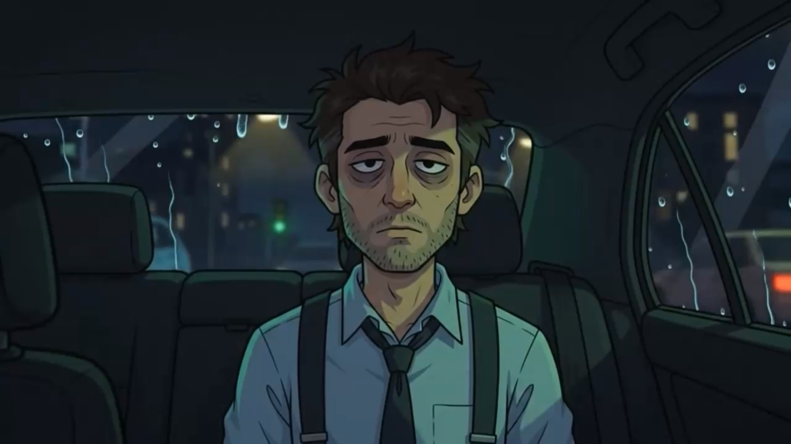

# Do Roteiro a Cena Final

## 🎯 1. Roteiro Completo

**TÍTULO:** A Rotina

**LOGLINE:** Um curta demonstrando a vida de um individuo preso na rotina, sem brecha para distrações.

**PERSONAGEM PRINCIPAL:**
- **Nome:** Gregory
- **Aparência:** Homem na faixa dos 30 anos, com olheiras marcadas e uma expressão de cansaço crônico (o olhar fixo de quem está "no piloto automático"). Ele tem cabelo castanho curto e levemente desgrenhado, e uma barba por fazer de dois dias.
- **Personalidade:** Puro burnout

**CENÁRIO:**
- **Local:** Ônibus, Metrô, Uber
- **Época/Atmosfera:** Começo da manhã até o nascer da lua.

**ESTRUTURA DAS CENAS:**
- **Cena 1: O Ônibus Lotado:**
  - *O que acontece:* O personagem está em pé no centro da tela, segurando a barra superior do ônibus com uma das mãos. Enquanto ele permanece completamente congelado e olhando para a câmera, o mundo ao seu redor é caótico. O cenário de fundo (janelas do ônibus) passa rapidamente revelando a luz da manhã, e silhuetas de outros passageiros esbarram nele e se movem de forma acelerada. A iluminação oscila enquanto o ônibus passa por baixo de árvores e viadutos.
  - *Enquadramento de Câmera:* Plano Médio (mostrando o personagem da cintura para cima).
  - *Duração:* 9 segundos.

- **Cena 2: O Vagão do Metrô:**
  - *O que acontece:* O personagem agora está sentado no metrô, na exata mesma posição central da tela e com a mesma expressão vazia. As luzes fluorescentes do vagão piscam levemente e refletem em seus olhos. O fundo mostra as janelas do metrô, onde cabos e luzes dos túneis subterrâneos passam em alta velocidade. O vagão trepida, fazendo o cabelo e a gravata do personagem balançarem sutilmente, mas seu olhar fixo na câmera e seu corpo continuam imóveis, simbolizando o transe da rotina.
  - *Enquadramento:* Close-up (focando do peito para cima, destacando a expressão facial).
  - *Duração:*  9 segundos.
- **Cena 3: O Banco de Trás do Uber:**
  - *O que acontece:* O personagem está sentado no centro do banco traseiro de um carro. O ambiente é noturno. Gotas de chuva escorrem em estilo cartoon pelas janelas laterais. Sombras e luzes de semáforos (vermelho, amarelo, verde) e neons da cidade banham o interior do veículo, varrendo o rosto do personagem em um ritmo melancólico e hipnótico. Ele continua perfeitamente centralizado, olhando para o além através da câmera. A cena escurece gradativamente (fade out) enquanto o carro freia suavemente.
  - *Enquadramento:* Plano Geral (mostrando o personagem de corpo inteiro sentado no banco de trás, com parte dos bancos da frente e as janelas laterais visíveis).
  - *Duração:*  9 segundos.

---

## 📝 2. Prompts Utilizados (e Tentativas)

### 2.1 Roteiro (Texto)
**Prompt usado para gerar a história:**
> "Escreva um roteiro breve para um vídeo de animação 2D de 25 a 30 segundos, estilo cartoon, dividido em exatamente 3 cenas de 8 a 10 segundos cada. O tema é a passagem do tempo, onde o personagem na cena fica centralizado e mostra a cada lugar que a maioria dos trabalhadores passa no cotidiano, exemplo: dentro do ônibus, metrô ou até uber olhando pro além/para a câmera. Para cada cena, descreva: o que acontece, o enquadramento de câmera (plano geral, plano médio ou close-up) e a duração aproximada. Inclua também uma descrição física detalhada do personagem principal, que deve se manter idêntica em todas as cenas. Formate a resposta em tópicos."

**Tentativas que não funcionaram:** A primeira geração do roteiro acabou deixando o enredo muito mais deprimente, demonstrando o quão isolado a mente do personagem estava no momento. (Background não compondo nenhuma pessoa, celular com tela rachada)

### 2.2 Concept Art (Imagem)
**Prompt do Personagem:**
> "Personagem original de animação 2D estilo cartoon, inspirado esteticamente no arquétipo do trabalhador corporativo exausto (referência de estilo: animações urbanas modernas e cotidianas): homem na faixa dos 30 anos com olheiras profundas e olhar vazio, cabelo castanho levemente desgrenhado e barba por fazer, vestindo camisa social azul-clara levemente amassada com as mangas dobradas, gravata cinza-escura frouxa no colarinho, calça social preta e alça de uma mochila. Vista frontal, corpo inteiro, fundo neutro, traços limpos e contornados, paleta de cores sóbrias e melancólicas."

#### Prompts dos Cenários:
**Cenário 1 - Ônibus**
> "Arte original de animação 2D estilo cartoon com traços limpos, paleta de cores sóbria e melancólica focada no cenário. Interior de um ônibus urbano lotado, com um background detalhado mostrando vários passageiros figurantes apertados em pé e sentados, mas mantendo o espaço central do corredor propositalmente vazio. A luz quente do sol matinal entra pelas janelas laterais, contrastando com o ambiente caótico interno."
> 
**Cenário 2 - Metrô**
> "Arte original de animação 2D estilo cartoon com traços limpos e paleta melancólica. Interior de um vagão de metrô subterrâneo com layout de bancos encostados nas paredes laterais, preenchido por diversos passageiros de fundo espremidos em pé e sentados, deixando um único assento central perfeitamente livre. A iluminação é fria, vinda de lâmpadas fluorescentes no teto, enquanto as janelas ao fundo mostram o rastro de luzes rápidas e borradas do túnel escuro passando em alta velocidade."
>
**Cenário 3 - Uber**
> "Arte original de animação 2D estilo cartoon com traços limpos e tons melancólicos. Visão interna do banco traseiro completamente vazio de um carro à noite. A atmosfera é urbana e chuvosa, com gotas de água escorrendo fortemente pelos vidros das janelas. O interior escuro do veículo é banhado suavemente por luzes neon da cidade e reflexos difusos de semáforos em vermelho, verde e amarelo que transpassam o vidro molhado e iluminam sutilmente os estofados."

**Tentativas que não funcionaram:** A primeira geração do personagem criou ele com uma bolsa e cabelo marrom, então foram poucas coisas para alterar.

### 2.3 Geração de Vídeo (Google Flow)
**Prompt Cena 1:**
> Cena 1: O Ônibus Lotado. Mantenha exatamente o estilo cartoonizado e traços do personagem principal. Homem de 30 anos, cansado, olheiras, camisa social azul amassada, gravata frouxa, segurando barra do ônibus. Estático e centralizado, olhando para a câmera. Ao redor, passageiros acelerados e luz da manhã oscilante passando pelas janelas. Estilo de desenho animado consistente com a referência.

**Prompt Cena 2:**
> Cena 2: O Vagão do Metrô. Mantenha exatamente o estilo cartoonizado e traços do personagem principal. Close-up do mesmo homem cansado, estático e centralizado olhando para a câmera. Sentado no metrô, luzes fluorescentes piscando. Pelo vidro, luzes do túnel passam em alta velocidade. Cabelo e gravata balançam sutilmente com a trepidação do vagão. Estilo de desenho animado consistente com a referência.

**Prompt Cena 3:**
> Cena 3: O Banco de Trás do Uber. Mantenha exatamente o estilo cartoonizado e traços do personagem principal. Mesma posição central e expressão vazia do homem, sentado no banco de trás à noite. Gotas de chuva escorrem pelas janelas laterais. Luzes de semáforos e neons da cidade banham o interior do carro em ritmo melancólico. Fade out gradual. Estilo de desenho animado consistente com a referência.

**Tentativas que não funcionaram:** Houve várias tentativas onde a IA gerou a cena do metrô totalmente igual ao do ônibus, também gerando mãos no suporte sem corpo visível. Durante a cena 2 ocorreu a geração de um vídeo realista do personagem, ignorando totalmente a última demanda do prompt.

---

## 🎨 3. Concept Arts

*(Substitua os links abaixo pelas imagens que você salvou. Se estiver no GitHub, coloque as imagens em uma pasta e referencie o caminho).*

### Personagem (Versão Final Aprovada)

### Cenários (Versão Final Aprovada)

**Variações Descartadas:**
-  *(Motivo do descarte: Estava um pouco similar com o protagonista do jogo Dispatch)*
-  *(Motivo do descarte: Mão flutuante)*

---

## 🎞️ 4. Frames do Vídeo Final

*(Extraia 1 frame de cada cena do seu vídeo usando o VLC ou ferramenta de captura de tela e salve na pasta)*

**Frame Representativo da Cena 1:**

**Frame Representativo da Cena 2:**

**Variação Descartada:**
-  *(Motivo do descarte: Não seguiu o estilo de cartoon 2D)*

**Frame Representativo da Cena 3:**

---

## 💰 5. Relato de Otimização de Custos

| Etapa | Ferramenta | Gerações/Interações | O que fizemos |
| :--- | :--- | :--- | :--- |
| **Roteiro** | Gemini | 2 iterações | Geramos o texto, ajustamos o cenário para ser mais simples. |
| **Concept Art** | Nano Banana | 4 imagens (2 personagens, 6 cenários) | Aprovamos a 2ª versão do personagem e a 5ª dos cenários. |
| **Cenas** | Google Flow | 4 vídeos gerados | A cena 2 precisou ser refeita pois o estilo fugiu do tema. |
| **Montagem** | VN | N/A | Cortes simples, houve problemas em mesclar os vídeos gerados pelo próprio Google Flow |

**O que faríamos diferente para gastar menos:**
> Fazer prompts mais específicos, sem brecha para ambiguidade, assim podendo evitar gerações inesperadas onde foge do tema pedido.
---

## 📦 6. Arquivos do Projeto
- **Vídeo Final (Video reduzido para 20s pelo limite de 10mb para upload) (MP4):** 

https://github.com/user-attachments/assets/1fc2b6a0-9288-4fa9-a441-d8dac32e22c5

- **Pasta de Imagens:** Todos os frames e concept arts estão na pasta `/assets` deste repositório.
