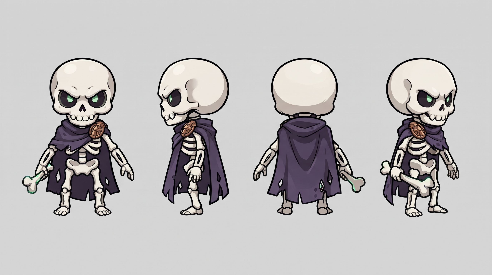
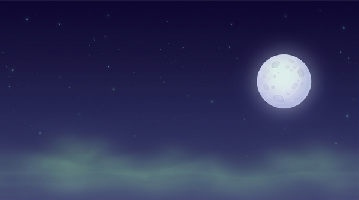
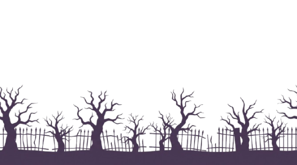
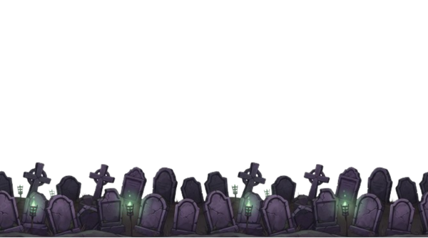
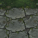

# Bones: O Guardião do Cemitério

## 🎮 Conceito do Jogo

Bones: O Guardião do Cemitério é um jogo de plataforma 2D em HTML5 Canvas, em arquivo único, no qual o esqueleto Bones percorre um cemitério noturno coletando 15 ossos sagrados para restaurar a paz do local. A cada 5 ossos coletados, Bones evolui (fica maior e mais forte), enquanto 3 fantasmas patrulham as plataformas como inimigos. O jogador tem 3 vidas, perde uma ao encostar em um fantasma e vence ao coletar todos os 15 ossos.

https://ai.studio/apps/5c126ea6-7a04-41b6-936b-c652a27fdd72
---
## 🚀 Como Executar

1. Baixe o arquivo `index.html`.
2. Crie uma pasta chamada `assets` no mesmo diretório do HTML.
3. Coloque todos os assets de imagem dentro da pasta `assets` (veja a lista abaixo).
4. Abra o arquivo HTML diretamente no navegador.
5. Pressione **ENTER** na tela inicial para começar a jogar.

**Controles:**
- **← →** ou **A / D**: mover Bones
- **ESPAÇO** ou **↑** ou **W**: pular
- **R**: reiniciar a fase
- **ENTER**: iniciar / reiniciar nas telas de menu, game over e vitória
- **Clique no canvas**: também inicia/reinicia nas telas

## 🖼️ Assets Necessários

Todos os assets devem ser **PNG com fundo transparente** (exceto `bg_sky.png`, que pode ter fundo sólido) e ficar dentro da pasta `assets/`. Os nomes devem ser **exatamente** os listados abaixo.

| Arquivo | Dimensão recomendada | Descrição |
|---|---|---|
| `bones_idle.png` | **32x48 px** | Bones parado (pose única) |
| `bones_walk.png` | **128x48 px** (4 quadros de 32x48 lado a lado) | Bones andando (ciclo de 4 quadros) |
| `bones_jump.png` | **32x48 px** | Bones pulando (pose única) |
| `enemy.png` | **36x40 px** | Fantasma inimigo (pose única, espelhada no código quando vai para a esquerda) |
| `bone.png` | **26x26 px** | Osso coletável (com brilho verde) |
| `bg_sky.png` | **960x540 px** | Céu noturno do cemitério (camada 0% de parallax) |
| `bg_trees.png` | **960x540 px** | Silhuetas de árvores e cerca (camada 15% de parallax) |
| `bg_graves.png` | **960x540 px** | Lápides e cruzes no meio-plano (camada 40% de parallax) |
| `tile_ground.png` | **64x64 px** (quadrado, seamless) | Textura do chão do cemitério (repetida nas plataformas) |

> ⚠️ **Importante**: se algum arquivo não existir, o código desenha um retângulo colorido no lugar (fallback), mas o jogo continua rodando. Para a entrega final, todos os assets devem estar presentes.

## 🖼️ Prints dos Assets

### Model sheet do Bones

### Camadas do cenário

## 🧩 Estrutura do Código (4 blocos)

O código foi organizado em quatro blocos claramente separados e comentados, conforme solicitado:

### 1. ESTADO
Define as **constantes de física e gameplay** (gravidade, velocidade, força do pulo, velocidade dos inimigos, modificadores de evolução, dimensões do mundo, vidas e total de ossos), o **mapeamento dos assets**, o **sistema de áudio retrô** (Web Audio API), a **lista de plataformas** do cenário, o **estado mutável do jogo** (jogador, 15 ossos, 3 inimigos, partículas, câmera, banner de evolução) e as funções de **carregamento de imagens** com fallback.

### 2. ENTRADA
Gerencia os **eventos de teclado** (setas, A/D, espaço, W, ↑, R, ENTER), os **controles touch** para dispositivos móveis, o **clique no canvas** para iniciar/reiniciar e o **botão de áudio** (ativar/mudo). Inclui trava de pulo (`jumpLocked`) para evitar pulo contínuo ao segurar a tecla.

### 3. REGRAS
Contém a **lógica central do jogo** a cada frame:
- Movimentação horizontal e salto do jogador (com modificadores por evolução)
- Gravidade e colisão com o topo das plataformas
- Patrulha dos 3 fantasmas com pausa de 0,5s nas bordas
- Colisão jogador × inimigo (perda de vida + invulnerabilidade de ~1,5s)
- Coleta dos 15 ossos e evolução a cada 5 (escala visual: 1.0x, 1.25x, 1.5x, 1.8x)
- Câmera horizontal suave seguindo o jogador
- Atualização de partículas e banner de evolução
- Funções `reiniciarJogo()` e `spawnParticles()`

### 4. RENDER
Desenha o quadro completo no Canvas 2D:
- Zoom de 10% no mundo (sem afetar o HUD)
- Três camadas de parallax (céu a 0%, árvores a 15%, lápides a 40%)
- Chão montado repetindo `tile_ground.png` (64x64) nas plataformas
- 15 ossos com efeito de flutuação (bob) e brilho verde
- 3 fantasmas com halo roxo e espelhamento horizontal
- Bones com seleção de sprite (idle/walk/jump), espelhamento e escala por evolução
- Partículas de coleta, dano e evolução
- HUD centralizado (vidas, "Evolução: X/3", "Ossos: X/15" e barra de progresso)
- Telas de START, GAMEOVER e VICTORY

**Game loop**: `loopJogo()` chama `atualizarRegras()` e `renderizar()` via `requestAnimationFrame`, rodando a ~60 FPS.

## 📝 Prompts Usados (por etapa)

### Etapa 1 — Conceito
Gênero definido: plataforma 2D (pular e coletar). Personagem: Bones, um esqueleto pequeno, fofo e determinado, com capa roxa e porrete de osso. Cenário: cemitério noturno simples, com céu estrelado, árvores distantes e lápides no meio-plano. Objetivo: coletar 15 ossos para restaurar a paz do cemitério. A cada 5 ossos, Bones evolui visualmente.

### Etapa 2 — Ficha textual do personagem
    PERSONAGEM: Bones
    
    small skeleton, cute and heroic style
    round white skull with big dark eye sockets and a tiny toothy grin
    body proportion 1:4 (stylized, heroic)
    wears a tattered dark purple cape with a bronze clasp on the RIGHT shoulder
    holds a small bone club in the LEFT hand
    palette: off-white bone, dark purple, bronze, dark grey outline, accent color: glowing green
    expression: determined, slightly mischievous, never sad
    
### Etapa 3 — Model sheet (Nano Banana Pro)
    Create a character model sheet for a 2D platformer video game.

    CHARACTER: small skeleton, cute and heroic style, round white skull with big dark eye sockets and a tiny toothy grin, body proportion 1:4 stylized, tattered dark purple cape with a bronze clasp on the RIGHT shoulder, holds a small bone club in the LEFT hand, palette of off-white bone, dark purple, bronze, dark grey outline and glowing green accent, determined mischievous expression.
    LAYOUT: Four full-body views in a single horizontal row, evenly spaced: front view, left side view, back view, three-quarter view. Identical height, identical proportion and identical scale across all four views. Neutral A-pose, arms slightly away from the body.
    STYLE: 2D hand-painted game art, bold clean black outlines, flat cel shading, limited 5-color palette, readable silhouette.
    TECHNICAL: Plain light grey background, even soft frontal lighting, no cast shadows, no text, no labels, no arrows, no watermark, no logo. High detail on the skull and the cape clasp.

### Etapa 4 — Sprites (Nano Banana Flash, por edição)

Walk cycle: 

    Using EXACTLY this character, without changing any design detail, generate a walk cycle sprite sheet.
    
    LAYOUT: four full-body frames in a single horizontal row, side view (facing right), evenly spaced, same height and same scale in all frames, feet aligned on the same ground line.
    FRAMES: 1) contact pose, 2) down pose, 3) passing pose, 4) up pose.
    TECHNICAL: fully transparent background (PNG alpha), flat even lighting, NO cast shadow on the ground, no text, no frame numbers, no grid lines, no watermark.

Poses de ação:

    Using EXACTLY this character, without changing any design detail, generate four separate action poses in a single horizontal row, side view facing right:

    IDLE — standing, bone club resting on shoulder, cape slightly moving
    JUMP — mid-air, knees bent, cape trailing upward
    ATTACK — bone club swung forward, body twisted
    HIT — recoiling backwards, off balance, skull tilted
    
    Same height, same scale, same art style in all four.
    TECHNICAL: fully transparent background, no cast shadow, no motion blur, no speed lines, no text, no watermark.

Folha de expressões: 

    Using EXACTLY this character, without changing any design detail, generate a facial expression sheet.
    
    LAYOUT: six head-and-shoulders portraits in a 3x2 grid.
    EXPRESSIONS: neutral, determined, angry, surprised, exhausted, relieved.
    
    Keep the exact same face shape, skin tone, head shape, hood and palette as the reference image.
    TECHNICAL: plain light grey background, same art style, same line weight, no text, no labels under the faces, no watermark.
    
### Etapa 5 — Cenário e itens (Nano Banana Flash + Pro)

Céu: 
    
    Background sky layer for a 2D side-scrolling platformer game.

    CONTENT: dark blue-purple night sky with faint green mist near the horizon and a few distant stars. A large pale moon on the right side. Nothing else — no clouds, no ground, no characters.
    TECHNICAL: 16:9 ratio, horizontally seamless (left edge must tile with right edge), no text, no watermark.

Árvores distantes: 

    Distant background layer for a 2D side-scrolling platformer game.
    
    CONTENT: silhouettes of dead trees and a broken iron cemetery fence, ONLY the silhouettes, in a single flat dark purple tone. No sky, no ground, no detail inside.
    TECHNICAL: fully transparent background above the silhouettes, horizontally seamless, 16:9 ratio, lower half empty, no text, no watermark.

Lápides (meio-plano): 

    Mid-distance background layer for a 2D side-scrolling platformer game.
    
    CONTENT: a row of crooked gravestones and stone crosses, in dark grey and muted purple, slightly more detailed than a silhouette. Faint green glow from small torches between the graves.
    TECHNICAL: fully transparent background, horizontally seamless, 16:9 ratio, empty lower third for gameplay, no text, no watermark.

Tileset do chão: 

    Seamless tileable game texture: old cemetery ground with dark grass and cracked stone path, top-down flat view.
    
    STYLE: stylized 2D hand-painted game art, dark green grass with grey stone patches and small purple flowers.
    TECHNICAL: perfectly tileable on ALL FOUR edges (the texture must repeat with no visible seam), square 1:1 ratio, completely flat and even lighting, NO directional shadow, no perspective, no vignette, no text, no watermark.

Osso coletável: 

    Using the same art style, palette and line weight as the attached character sheet, generate one game collectible asset:
    
    COLLECTIBLE — a single glowing bone, small and readable at 32x32 pixels, with a soft green glow around it.
    TECHNICAL: fully transparent background, flat lighting, no cast shadow, no text, no background scenery, no watermark.

Inimigo (fantasma):

    Using the same art style, palette and line weight as the attached character sheet, generate one game enemy asset:
    
    ENEMY — a small hostile ghost wisp, pale white with two glowing green eyes, side view facing left, same proportion scale as the character's lower leg.
    TECHNICAL: fully transparent background, flat lighting, no cast shadow, no text, no background scenery, no watermark.
### Etapa 6 — Construção do jogo (Google AI Studio, modo Build)
    Crie um jogo de plataforma 2D chamado "Bones: O Guardião do Cemitério", que rode direto no navegador, em HTML5 Canvas, em um ÚNICO arquivo HTML, sem bibliotecas nem dependências externas.

    MECÂNICA:

    Setas esquerda/direita movem o personagem; barra de espaço pula.
    Gravidade constante; o personagem colide com o topo das plataformas.
    Espalhe 15 ossos pelo mapa. Coletar todos vence a fase.
    A cada 5 ossos coletados, o personagem "evolui": fica visualmente maior e o HUD mostra "Evolução: X/3".
    3 inimigos (fantasmas) patrulham plataformas indo e voltando.
    Encostar num inimigo: perde 1 de 3 vidas e volta ao ponto inicial.
    Vidas zeradas: tela de "Fim de jogo" com opção de reiniciar.

    CÂMERA E CENÁRIO:

    A câmera segue o personagem horizontalmente.
    Fundo em 3 camadas com parallax: bg_sky.png a 0%, bg_trees.png a 15%, bg_graves.png a 40% da velocidade da câmera.
    O chão é montado repetindo tile_ground.png.

    ASSETS (carregue da pasta /assets com estes nomes exatos):
    bones_idle.png, bones_walk.png (4 quadros lado a lado), bones_jump.png, enemy.png, bone.png, bg_sky.png, bg_trees.png, bg_graves.png, tile_ground.png
    Se um arquivo não existir, desenhe um retângulo colorido no lugar, mas mantenha o nome do arquivo no código.

    INTERFACE:

    HUD no topo esquerdo: vidas (3 ícones), contador "ossos: X/15" e "evolução: X/3".
    Fonte sem serifa, texto branco com contorno escuro.
    Paleta da interface: off-white, roxo escuro, verde brilhante.

    TÉCNICO:

    Todo o código comentado em português.
    Organize o código em quatro blocos claramente separados e comentados: ESTADO, ENTRADA, REGRAS, RENDER.
    O game loop deve usar requestAnimationFrame.
    Velocidades e gravidade em constantes no topo, fáceis de ajustar.

### Etapa 7 — Ajustes de game feel (Google AI Studio)

    O pulo está muito flutuante. Aumente a gravidade em 40% e reduza a força do pulo em 20%. Não altere mais nada.

    Os inimigos estão rápidos demais. Reduza a velocidade deles pela metade e adicione uma pausa de 0,5 segundo ao chegar na ponta da plataforma. Não altere mais nada.

    Adicione um efeito visual quando um osso é coletado: o osso some com um brilho verde que se expande e desaparece em 0,3s. Não altere mais nada.

    Adicione uma tela inicial com o título "BONES: O GUARDIÃO DO CEMITÉRIO", o subtítulo "setas para mover · espaço para pular" e "pressione ENTER para começar". Mesma paleta do HUD. Não altere mais nada.

## 🤖 Declaração de Uso de IA

| Etapa | Ferramenta | Uso |
|---|---|---|
| 1. Conceito | Caderno / humano | Definição do gênero, personagem Bones e cenário cemitério |
| 2. Ficha textual | Caderno / humano | Vocabulário travado do personagem (paleta, proporção, detalhes) |
| 3. Model sheet | Nano Banana Pro | Geração das 4 vistas do Bones |
| 4. Sprites | Nano Banana Flash (edição) | Walk cycle, poses de ação (idle, jump, attack, hit) e folha de expressões |
| 5. Cenário | Nano Banana Flash + Pro | 3 camadas de parallax (céu, árvores, lápides) + tileset seamless do chão |
| 5. Item e inimigo | Nano Banana Flash | Osso coletável e fantasma inimigo |
| 6. Construção do jogo | Google AI Studio (modo Build) | Geração do código HTML5 Canvas em arquivo único |
| 7. Integração | Google AI Studio + Photopea | Recorte, redimensionamento (32x48 etc.) e upload dos assets na pasta `assets/` |
| 8. Ajustes de game feel | Google AI Studio (iterações) | Calibragem de gravidade, velocidade de inimigos, efeitos visuais e tela inicial |
| 9. Documentação | Claude / Gemini | Geração deste README.md a partir do código final |

> **Nota**: todas as imagens geradas pelo Nano Banana carregam a marca d'água digital invisível **SynthID**, que as identifica como geradas por IA. Nenhum personagem, rosto ou asset de terceiros foi reproduzido — o personagem Bones e o cenário do cemitério são originais.

## 💰 Relato de Custo

| Etapa | Gerações estimadas | Observação |
|---|---|---|
| Model sheet (Bones) | 1–3 | Nano Banana Pro |
| Walk cycle | 2–3 | Nano Banana Flash (edição) |
| Poses de ação | 2–3 | Nano Banana Flash (edição) |
| Folha de expressões | 2–3 | Nano Banana Flash (edição) |
| Osso coletável + inimigo | 1–3 | Nano Banana Flash (edição) |
| Céu | 2–3 | Nano Banana Flash |
| Árvores distantes | 1–3 | Nano Banana Flash |
| Lápides (meio-plano) | 2–3 | Nano Banana Flash |
| Tileset do chão | 2–6 | Nano Banana Pro (precisão de seamless) |
| **Total** | **20–30 gerações** | Dentro da faixa esperada para um protótipo completo |

**O que faria diferente**: teria testado **outros estilos primeiro** (ex.: pixel art, hand-painted, cartoon) em vez de focar em um só desde o início. Isso teria evitado retrabalho e permitido escolher o estilo com mais segurança antes de gerar todos os assets. Também salvaria todos os prompts em uma pasta `/prompts` desde o começo, para facilitar a reprodução.

